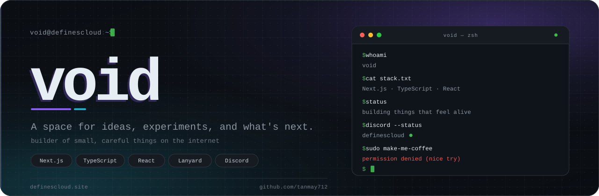
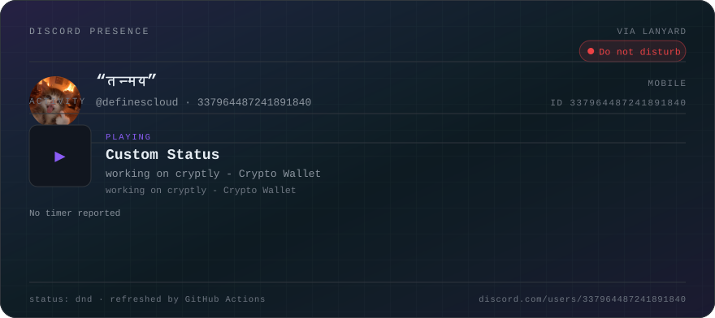
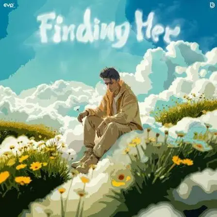

<div align="center">



<br>

<a href="https://definescloud.site"></a>
<a href="https://discord.com/users/337964487241891840"></a>
<a href="mailto:void@definescloud.site"></a>
<a href="https://github.com/tanmay712"></a>

</div>

---

## `whoami`

```txt
void@definescloud:~$ whoami
void — also known as definescloud

  role      builder of small, careful things
  focus     interfaces · motion · live presence
  stack     Next.js · React · TypeScript · Tailwind · Node.js
  site      definescloud.site
  github    tanmay712
  discord   definescloud
  status    open to ideas, experiments, and good conversations
```

Hey, I'm **void** — also known as **definescloud**. This is my corner of the internet: a place for ideas, experiments, and things worth sharing. The story is still being written, and the best parts are usually the ones that haven't shipped yet.

---

## `presence` — live from Discord

<div align="center">

[](https://discord.com/users/337964487241891840)

<br>

<sub>Status, activity, and Spotify — generated from [Lanyard](https://github.com/Phineas/lanyard) and refreshed every 5 minutes by GitHub Actions.</sub>

</div>

> [!NOTE]
> **Want to see your own presence here?** Join the [Lanyard Discord server](https://discord.gg/UrXF2cfJ7F), then enable **User Settings → Activity Privacy → Share your detected activities**. For Spotify, also enable **Settings → Connections → Spotify → Display Spotify as your status**. The card updates itself — no tokens, no secrets, no browser calls.

<details>
<summary><strong>How this card is built</strong></summary>

<br>

- The card is a dependency-free SVG generated by [`scripts/update-discord-presence.mjs`](scripts/update-discord-presence.mjs) from Lanyard's public API — no token, secret, or browser call.
- [`.github/workflows/discord-presence.yml`](.github/workflows/discord-presence.yml) runs that generator every 5 minutes and commits only when the card changes, so the image in this README stays current.
- Small images (avatar, album art, app icons) are inlined as data URIs, because GitHub's camo proxy does not fetch external references from inside an SVG.
- Prefer a hosted renderer? The open-source [discord-activity-card](https://github.com/AdityaLF/discord-activity-card) service renders a live card on demand from the same Lanyard data.

</details>

---

## `tracks` — on rotation

The local player from my [Portfolio](https://github.com/tanmay712/Portfolio), in track order. These are listening picks bundled with the site — **not tracks I authored**.

| # | Track | Artist | Album | Length | Listen |
|:-:|:--|:--|:--|:-:|:--|
| 01 |  **Finding Her** | Kushagra, Bharath | Finding Her | 3:18 | [▶](https://raw.githubusercontent.com/tanmay712/Portfolio/main/public/music/track-02.mp3) |
| 02 |  **Dil Tu Jaan Tu** | Gurnazar | Dil Tu Jaan Tu | 4:02 | [▶](https://raw.githubusercontent.com/tanmay712/Portfolio/main/public/music/track-03.mp3) |

<br>

<div align="center">

**▶ Play the full local library on [definescloud.site](https://definescloud.site)** — play/pause, previous/next, shuffle, repeat, seek, and volume.

</div>

<details>
<summary><strong>Full local library</strong> <code>(3 tracks, 10:54 total)</code></summary>

<br>

| # | Track | Artist | Album | Length | Note |
|:-:|:--|:--|:--|:-:|:--|
| 01 | Local track 01 | Unattributed template audio | Local library | 3:34 | Template placeholder |
| 02 | Finding Her | Kushagra, Bharath | Finding Her | 3:18 | Listening pick |
| 03 | Dil Tu Jaan Tu | Gurnazar | Dil Tu Jaan Tu | 4:02 | Listening pick |

<br>

Machine-readable version: [`data/tracks.json`](data/tracks.json)

</details>

---

## `work` — selected builds

### [Portfolio](https://github.com/tanmay712/Portfolio)

> A cinematic, command-driven personal portfolio built with Next.js, TypeScript, React, Tailwind CSS, Framer Motion, Lanyard, and the browser Audio API.

`TypeScript` `Next.js` `React` `Tailwind CSS` `Lanyard` `Netlify`

### [Quest-completerv2](https://github.com/tanmay712/Quest-completerv2)

> A Discord.js v14 bot template — a clean starting point for a Discord "App" with commands, config, and a place to grow.

`JavaScript` `Discord.js` `Node.js`

---

## `stack` — the toolbox

| Interface | Motion & visuals | Live presence | Deployment |
|:--|:--|:--|:--|
| Next.js · React · TypeScript · Tailwind CSS | Framer Motion · Lucide · Inter · JetBrains Mono | Discord · Lanyard · WebSockets | Netlify · Node.js · Git |

---

## `telemetry` — GitHub, tracked

<p align="center">
  
  
</p>

<div align="center">

| Commits | Pull requests | Repositories |
|:---:|:---:|:---:|
| **16** | **4** | **3** |

<sub>Public contributions over the last 12 months · snapshot via GitHub GraphQL</sub>

</div>

---

## `currently`

- 🔭 **Building** — a cinematic portfolio and small Discord tools
- 🎧 **Listening** — local picks, plus whatever the current Spotify queue is
- 💬 **Ask me about** — Next.js, TypeScript, Discord.js, Lanyard
- 🌐 **Elsewhere** — [definescloud.site](https://definescloud.site)

---

## `connect`

<div align="center">

<a href="https://discord.com/users/337964487241891840"></a>
<a href="mailto:void@definescloud.site"></a>
<a href="https://definescloud.site"></a>
<a href="https://github.com/tanmay712"></a>

<br>

<sub>If you made it this far, say hi. My inbox is open.</sub>

</div>

---

<div align="center">

<sub>Built with care · presence by <a href="https://github.com/Phineas/lanyard">Lanyard</a> · synced by <a href="https://github.com/tanmay712/Readme/actions">GitHub Actions</a></sub>

<br>


</div>
